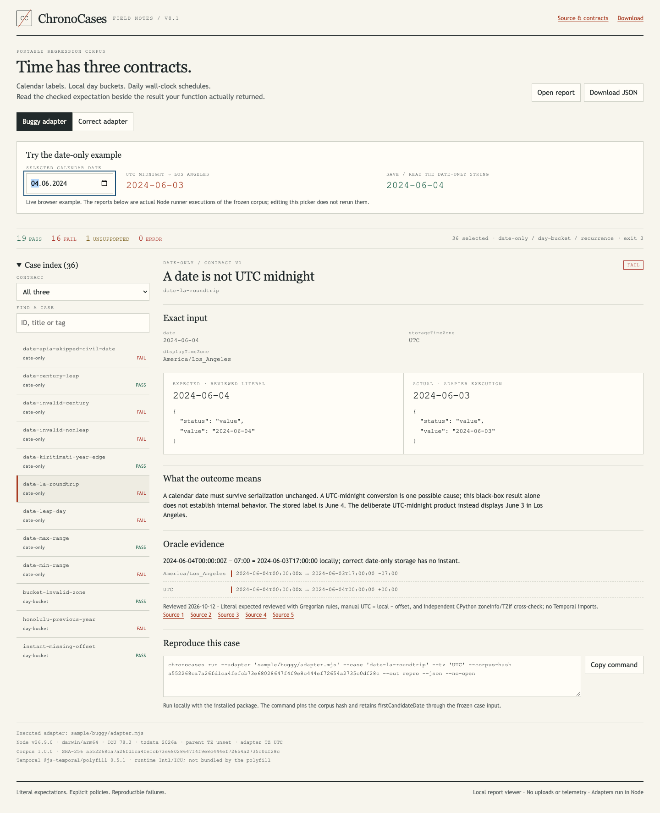
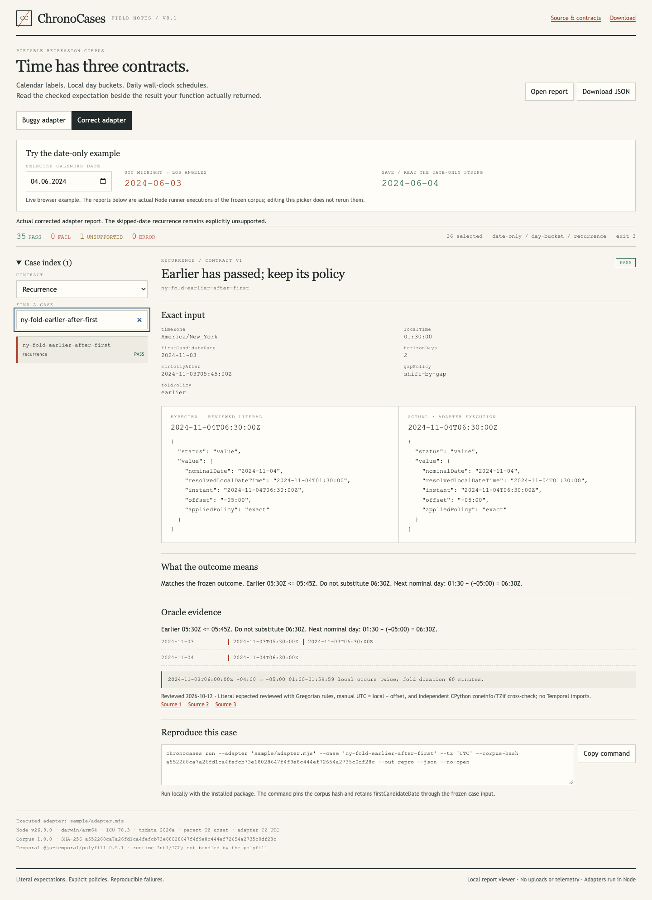

# ChronoCases

Prerelease **0.1.1-rc.1** fixes log fidelity and report consistency. See [migration](docs/MIGRATION-0.1.1.md), [result invariants](docs/REPORTS.md) and [external validation](docs/EXTERNAL-VALIDATION.md). Download the prerelease archive for these fixes; the hosted demo remains at v0.1.0 until the changes land on main.

Portable regression cases for **calendar dates**, **timezone day buckets** and **recurring schedules**.

Connect a local JavaScript function, compare its actual result with a reviewed literal, and reproduce one case with its input, policies and corpus hash intact. ChronoCases is an experimental test corpus and Node runner. It complements your unit tests and fake clock; a passing report establishes these cases, not correctness of an entire application.

[Try the offline-capable explorer](https://mikonyaa.github.io/chronocases/) · [Download v0.1.1-rc.1](https://github.com/mikonyaa/chronocases/releases/tag/v0.1.1-rc.1) · [Contracts](docs/contracts.md) · [Oracle ledger](oracle/ledger.md)



The picker selects **2024-06-04**. The built-in broken product serializes UTC midnight and displays **2024-06-03** in Los Angeles. The report is from its real Node adapter execution. Switching to the corrected adapter preserves June 4 and passes the same supported corpus.



At cursor `2024-11-03T05:45:00Z`, New York's `earlier` policy skips the passed `05:30Z` candidate and returns **November 4, 06:30Z**. `later` returns **November 3, 06:30Z**. These are separate frozen cases, not interchangeable fallbacks. Screenshots are captured with [this reproduction script](https://github.com/mikonyaa/chronocases/blob/main/scripts/capture-demo.mjs); [demo notes](docs/demo.md) describe the actual functions.

## Choose the contract

| Contract | Use it for | Value |
| --- | --- | --- |
| `date-only` | Birthday, invoice date, selected calendar label | The same canonical `YYYY-MM-DD` after your save/read path |
| `day-bucket` | Group an unambiguous instant by a specified user's local day | `YYYY-MM-DD` in the requested IANA zone |
| `recurrence` | The next daily wall-clock occurrence in an explicit date window | Nominal date, resolved local datetime, instant, offset and applied policy |

There are **36 frozen reviewed cases**: 9 date-only, 11 day-bucket and 16 recurrence. The correct example has **35 PASS, 0 FAIL, 1 UNSUPPORTED**. Apia's skipped civil date is an intentional negative self-test of a documented recurrence limit; it counts as uncovered, even when correctly declined. Expected invalid-input rejections and an exhausted window count as normal passing outcomes.

## Install the release archive

Use Node **22.13+** with full ICU. The package is distributed through GitHub Releases; **it is not published to npm**.

```sh
mkdir my-time-tests
cd my-time-tests
npm init -y
npm install https://github.com/mikonyaa/chronocases/releases/download/v0.1.1-rc.1/chronocases-0.1.1-rc.1.tgz
./node_modules/.bin/chronocases --version
./node_modules/.bin/chronocases doctor
./node_modules/.bin/chronocases init --dir sample
./node_modules/.bin/chronocases run --adapter sample/adapter.mjs --out results --json --no-open
```

The last full-corpus run returns **exit 3** for the declared unsupported Apia transition. Its JSON retains all 36 results and shows zero business failures. To run a fully supported selection:

```sh
./node_modules/.bin/chronocases run --adapter sample/adapter.mjs --contract date-only --out date-results
./node_modules/.bin/chronocases run --adapter sample/adapter.mjs --case ny-fold-earlier-after-first --out repro
./node_modules/.bin/chronocases explorer --report results/report.json --out explorer.html --no-open
```

Open `explorer.html` directly; it needs no server, CDN or account. `chronocases-explorer-example.zip` in the Release includes the standalone viewer, real correct/buggy reports and a small example bundle. The viewer reads reports and runs the built-in date-picker demonstration. Product adapters execute locally in Node.

## Connect your function

Implement only the contracts you want to select. In `sample/adapter.mjs`, replace the sample product calls with your application's real functions:

```js
import { saveCalendarDate, readCalendarDate } from './my-product.mjs';

export async function dateOnlyRoundtrip(input, metadata) {
  // Your save/read path must validate the Gregorian date before storage.
  try {
    const id = await saveCalendarDate(input.date, input.storageTimeZone);
    const date = await readCalendarDate(id, input.displayTimeZone);
    return { status: 'value', value: date };
  } catch (error) {
    if (error.code === 'INVALID_CALENDAR_DATE') {
      return { status: 'rejected', reasonCode: 'INVALID_DATE' };
    }
    throw error; // Unexpected errors remain adapter errors.
  }
}
```

The runner passes **input** plus `{ caseId, contractVersion }`; it never passes expected. A missing selected export is unsupported. Every case gets a separate runner-owned Node child with an explicit `TZ`, timeout and bounded logs. IPC carries the normalized outcome; `console.log` cannot impersonate it. Adapters are trusted local code, **not a security sandbox**.

[Full API and reason codes](docs/adapter.md) · [Compiled TypeScript example](examples/typescript/adapter.ts) · [Vitest example](examples/vitest/date-only.test.ts) · [Jest ESM example](examples/jest/date-only.test.mjs)

```js
import { loadCase, evaluateOutcome } from 'chronocases';
const fixture = await loadCase('date-la-roundtrip');
const actual = await myFunction(fixture.input);
const { passed, explanation } = evaluateOutcome(fixture, actual);
```

The helper runs in your test process. The CLI provides process isolation. The generated TypeScript example is compiled with ordinary `tsc -p sample/typescript/tsconfig.json`; run `sample/typescript/compiled/adapter.js`. No `ts-node` loader is required. See [framework commands](docs/adapter.md#test-frameworks).

## Reproduce and inspect

```sh
./node_modules/.bin/chronocases list --contract recurrence
./node_modules/.bin/chronocases explain ny-fold-earlier-after-first
./node_modules/.bin/chronocases run --adapter sample/buggy/adapter.mjs --case ny-fold-earlier-after-first --out repro --json
./node_modules/.bin/chronocases demo --out demo-output --no-open
```

The buggy single case intentionally exits **1**. Its report includes exact input, expected/actual, an explanation and a real copyable command with `--corpus-hash`. `demo` exits 0 only after writing and checking both example runs, retaining their intentional failures and unsupported status. `--json` gives a schema-versioned summary. No command automatically opens a browser.

| Run exit | Meaning |
| --- | --- |
| 0 | All selected cases pass |
| 1 | Business mismatch or invalid return shape |
| 2 | Input/selection error, adapter throw/crash, timeout, log/result limit or runtime error |
| 3 | Unsupported environment, missing selected export or unsupported recurrence transition |
| 130 | Interrupted; only runner-owned children are terminated |

For mixed outcomes, priority is **2 → 3 → 1 → 0**, with an explicit interrupt returning 130. All evaluated results remain in JSON. `NO_OCCURRENCE_IN_WINDOW` is a normal finite-window outcome, not a technical timeout.

## Why trust these expectations?

Expected values are committed literals, reviewed using Gregorian rules, explicit `UTC = local − offset` arithmetic, historical IANA transition evidence and an independent **CPython zoneinfo/TZif** checker. The reference example uses pinned `@js-temporal/polyfill` 0.5.1 and runtime Intl/ICU; it is **not the oracle** and does not bundle a pinned timezone database.

`oracle/corpus-integrity.json` freezes every case's exact bytes and the aggregate SHA-256. Normal tests never regenerate expected. Before invoking the adapter, independent fixture canaries check the required zone, offset and local time. Mismatches become `UNSUPPORTED_ENVIRONMENT`, leaving expected untouched. A deliberately invalid zone is a separate business rejection case.

Reports include Node, OS/arch, ICU, available tzdata version (or `unknown`), parent/child TZ, supported timezone identifiers, Temporal implementation/version and corpus version/hash. [Oracle maintenance](docs/oracle.md) explains review requirements. The Release manifest identifies source commit, build origin, CI and asset checksums; it is a traceability record, not a cryptographic attestation.

## Verification and limits

Local validation: macOS arm64, Node 26.9.0, ICU 78.3, Node tzdata 2026a; independent Python 3.13.7 with system tzdata 2026d. CI exercises Linux x64 on Node 22/24/26 with different child TZ values, using the exact workflow results linked from the Release. Browser checks use isolated Chrome locally and Chromium in CI, at 1440/1024/390 px and as an offline file. These checks do not establish physical Safari or every browser support.

The v1 Gregorian range is 1900–2100 inclusive. Daily recurrence additionally requires the entire nominal window to fit the supported transition model. No cron/RRULE, monthly/business schedules, leap seconds, other calendars, browser/DB/Python adapters or arbitrary repository scanning. Passing these cases does not establish all zones, transitions or applications. [Detailed limits](docs/limitations.md) · [Existing tools and when a unit test is enough](docs/comparison.md)

Reports can include private inputs and logs. Do not upload or publish them blindly. The viewer has no telemetry, external scripts or upload service. See [SECURITY.md](SECURITY.md).

## Develop and contribute

```sh
git clone https://github.com/mikonyaa/chronocases.git
cd chronocases
npm ci
npm run typecheck
npm run lint
npm run test:unit
npm run verify:corpus
npm run build
npm run test:integration
npm run test:ui
npm run test:package
npm pack --json
```

Development-only independent oracle verification needs Python's standard-library `zoneinfo` and IANA TZif data. Python is not a consumer runtime dependency. Local UI tests use installed Chrome; CI installs Playwright Chromium. [Contribution instructions](CONTRIBUTING.md) · [MIT license](LICENSE) · [Third-party notices](THIRD_PARTY.md) · [Changelog](CHANGELOG.md)
